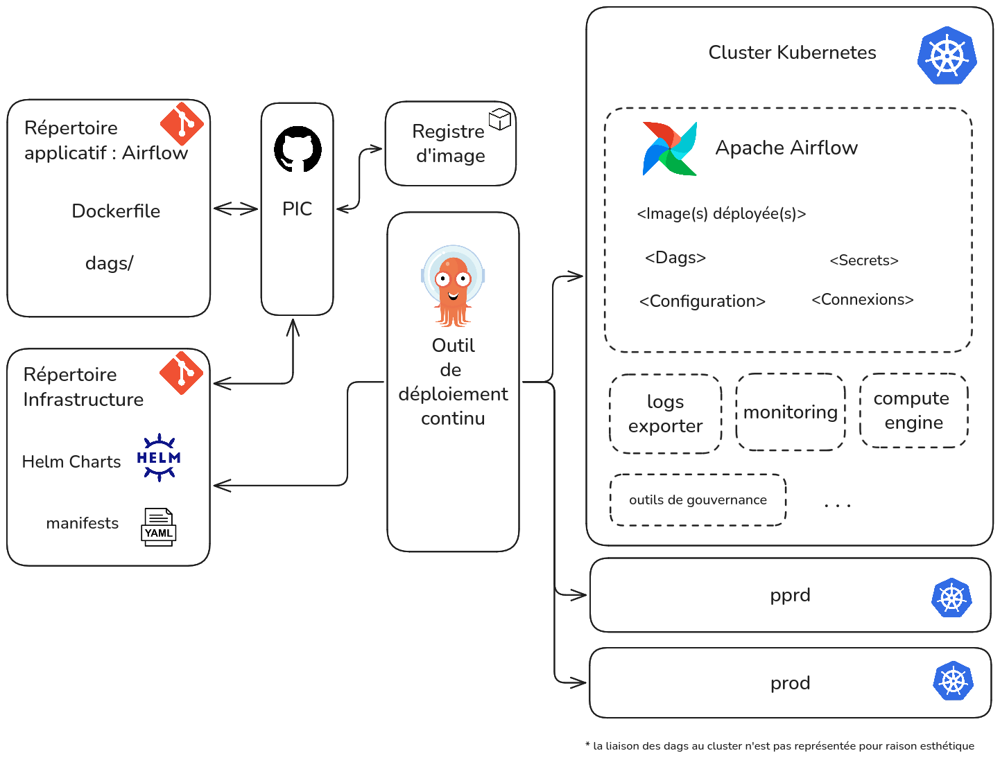
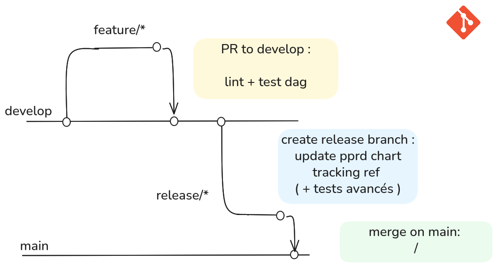
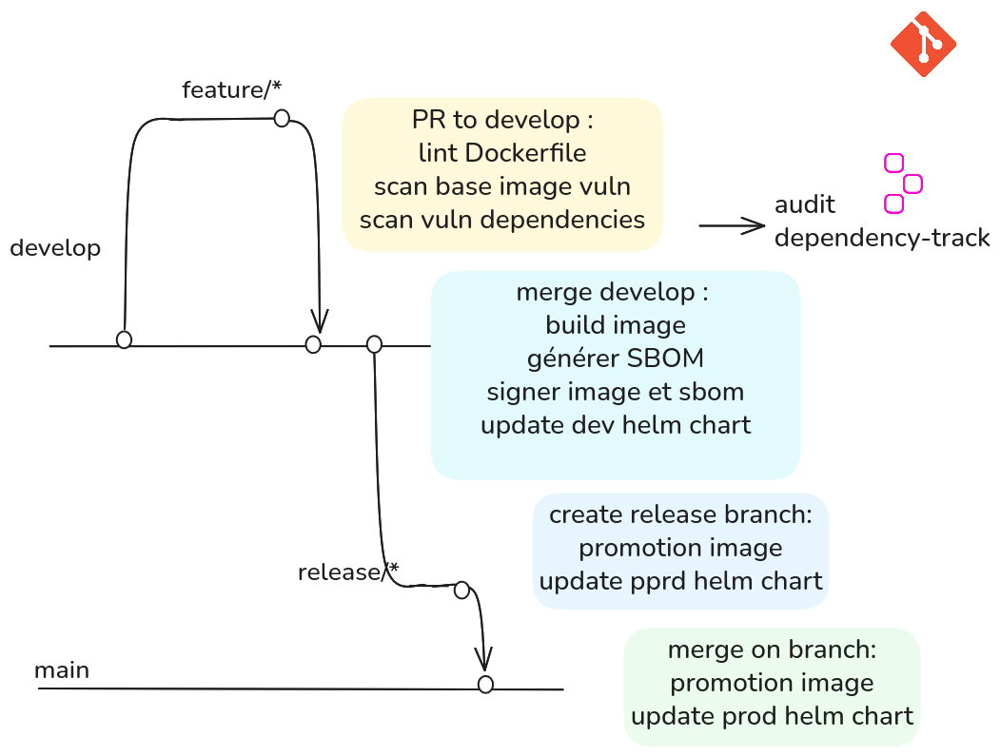
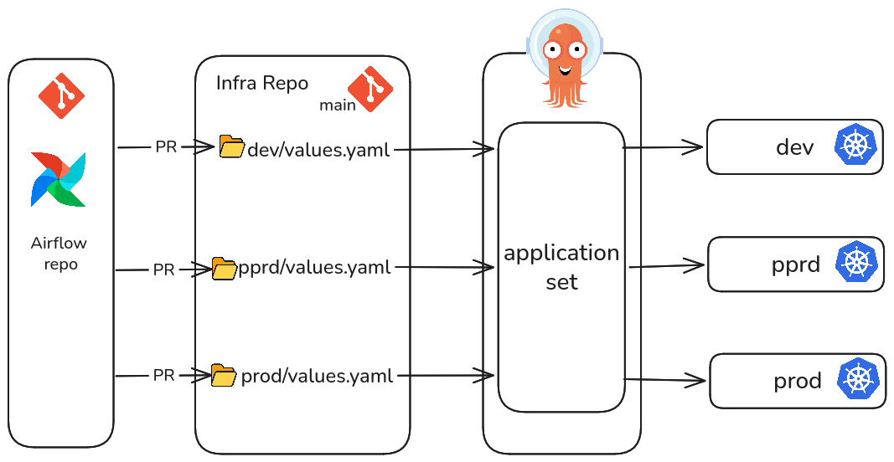
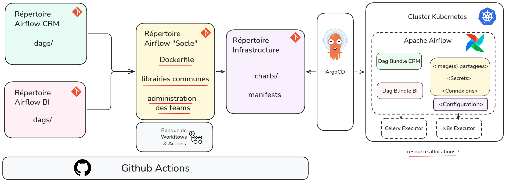

# DevSecOps: CI/CD Workflow for Apache Airflow on Kubernetes

## Overview

### The Challenge

**How can you automate the deployment and updates of an Apache Airflow cluster running on Kubernetes while maintaining security, reliability, and consistency across environments?**

This project addresses this challenge by implementing a secure, GitOps-driven CI/CD workflow built on three key technologies:

- **[GitHub Actions](https://github.com/features/actions)** — Automates CI workflows, including validation, testing, and artifact builds.
- **[Argo CD](https://argo-cd.readthedocs.io/)** — Automates application deployment and synchronization across Kubernetes environments using GitOps principles.
- **[Kyverno](https://kyverno.io/)** — Enforces security policies and validates Kubernetes resources.

Together, these tools provide an automated workflow for building, securing, and deploying Apache Airflow on Kubernetes.

🎥 **Watch the full demo:** [YouTube video (French)](<youtube link>)

The video provides a live demonstration and detailed explanations of the architecture and workflows.

---

## Table of Contents

- [Overview](#overview)
- [Repository Structure](#repository-structure)
- [Architecture](#architecture)
- [Continuous Integration: Apache Airflow](#continuous-integration-apache-airflow)
- [Continuous Delivery: Argo CD](#continuous-delivery-argo-cd)
- [Scaling the Architecture](#scaling-the-architecture)
- [Acknowledgments](#acknowledgments)

---

## Repository Structure

The project separates application development from infrastructure management using two repositories, each with a distinct responsibility.

| Repository | Responsibility | Delivery Goal | CI Goal |
|---|---|---|---|
| **Application Repository** | Defines what is developed and built, including Airflow DAGs, Docker images, dependencies, and other application artifacts. | Produce and promote application artifacts across environments while maintaining application quality. | Validate application changes, enforce security checks, and build versioned artifacts. |
| **Infrastructure Repository** | Defines what is deployed and how it is deployed, including Kubernetes manifests, Helm values, and deployment configuration. | Manage application deployments and maintain consistent configuration across environments. | Validate infrastructure configurations, enforce security checks, and ensure deployment manifests comply with established policies. |

### Application Repository

The application repository contains the source code and artifacts required to run Apache Airflow.

Typical responsibilities include:

- Developing and maintaining Airflow DAGs.
- Managing Python dependencies and other application components.
- Building and versioning Docker images.
- Running code quality checks and security scans.
- Publishing application artifacts.
- Promoting validated artifacts across environments.

### Infrastructure Repository

The infrastructure repository contains the configuration required to deploy and manage Apache Airflow on Kubernetes.

Typical responsibilities include:

- Maintaining Kubernetes manifests and Helm chart values.
- Managing environment-specific configuration.
- Validating deployment manifests.
- Enforcing security policies.
- Managing configuration changes through Git.
- Triggering deployments through Argo CD.

This separation of concerns makes application delivery more independent from infrastructure management while improving traceability, security, and maintainability.

---

## Architecture

The following diagram illustrates the overall CI/CD architecture, showing which applications are needed.

---

## Continuous Integration: Apache Airflow

Not all changes to Apache Airflow require the same deployment process.

This project distinguishes between two main categories of changes:

### 1. DAG and Configuration Changes

Examples include:

- Modifying an existing Python DAG (`.py`).
- Adding a new DAG.

These changes generally do not require rebuilding the Airflow Docker image.

**Deployment strategy:** Update the relevant application files and deliver them through the appropriate GitOps workflow.

The exact deployment mechanism depends on how DAGs and configuration files are provided to the Airflow cluster.

### 2. Docker Image Changes

Examples include:

- Adding or updating Python dependencies.
- Modifying the Dockerfile.
- Changing system packages or runtime dependencies.
- Upgrading the Apache Airflow version.
- Updating the base image or build configuration.

These changes require rebuilding the Docker image and publishing a new version.

**Deployment strategy:** Build and validate the image, publish it to the container registry, update the corresponding image reference in the infrastructure repository, and let Argo CD synchronize the deployment.

---

## Continuous Delivery: Argo CD

[Argo CD](https://argo-cd.readthedocs.io/) implements the continuous delivery component of the workflow using GitOps principles.

It continuously monitors the configured Git repositories and compares the desired application state with the actual state of the Kubernetes cluster.

When the infrastructure repository is updated, Argo CD detects the changes and synchronizes the cluster with the desired configuration, according to the application's synchronization policy.

### Deployment Workflow

1. A developer modifies the application code or dependencies.
2. GitHub Actions validates the changes and builds a new Docker image when necessary.
3. The resulting image is published to a container registry.
4. The infrastructure repository is updated with the appropriate image reference or Helm chart values.
5. Argo CD detects the configuration change.
6. Argo CD synchronizes the Kubernetes cluster with the desired state.
7. Kyverno policies validate applicable Kubernetes resources and enforce the configured security requirements.

Each environment can have its own Helm values file, allowing the same application artifact to be promoted across environments while keeping environment-specific configuration separate.

By separating image builds from deployment configuration, the workflow improves deployment traceability and helps ensure that each environment runs the intended application version.

---

## Scaling the Architecture

In larger organizations, a single application repository is often insufficient to accommodate multiple teams with different development cycles, dependencies, and delivery requirements.

The architecture can be extended to support multiple teams while preserving shared standards and centralized governance.

For organizations using Apache Airflow's multi-team capabilities, a possible approach is to introduce additional repositories dedicated to shared resources and reusable automation.

### Proposed Multi-Team Architecture

The architecture could be organized around three repository types:

| Repository | Purpose |
| --- | --- |
| **Team Application Repositories** | Store team-specific DAGs, application code, dependencies, and build configuration. |
| **Shared Image and Libraries Repository** | Maintain common Docker images, shared Python libraries, and reusable components. |
| **Shared CI/CD Repository** | Centralize reusable GitHub Actions workflows, composite actions, and common pipeline logic. |
| **Infrastructure Repository** | Manage deployment configuration and environment-specific Helm values for the Airflow platform. |

### Benefits

- **Team autonomy:** Teams can develop and deliver their own DAGs independently.
- **Standardization:** Shared workflows enforce consistent build, testing, and security practices.
- **Reusability:** Common libraries and Docker images reduce duplication.
- **Security:** Centralized policies and validation workflows improve governance.
- **Maintainability:** Shared CI/CD components simplify updates and reduce operational overhead.
- **Scalability:** New teams can adopt the established delivery process without duplicating the entire pipeline.

### Proposed Architecture

This architecture is a starting point rather than a one-size-fits-all solution. The repository boundaries and deployment strategy should be adapted to the organization's team structure, security requirements, and Airflow operating model.

---

## 🌟 Acknowledgments

Thank you for checking out this project!

If you find this repository useful, please consider giving it a ⭐ **star** on GitHub.

Your support helps make the project more visible and encourages further improvements.

If you would like to learn more about the implementation, watch the full demo on YouTube (French).
